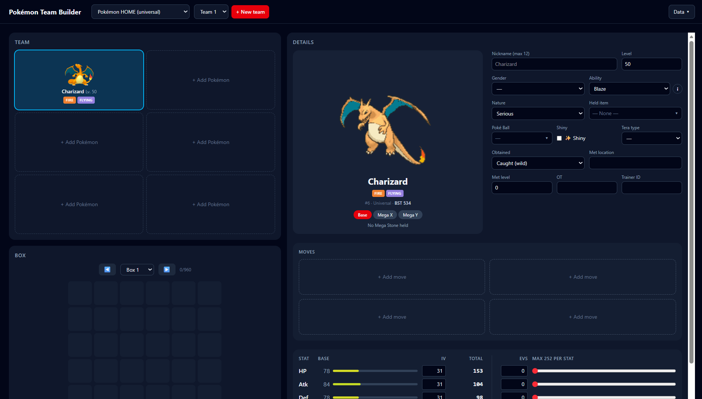

# Pokémon Team Builder

A game-accurate team builder and personal Pokémon storage box. Build teams for any main-series game from Red/Blue to Scarlet/Violet, with movesets, abilities, items and transfers that follow the real games' rules, then export them to **Pokémon Showdown** or **PKHeX**.

**▶ Live app: https://karthikkannan1.github.io/pokemon-team-builder/**



## Why

I replay older Pokémon games and wanted one place to keep the Pokémon I raise in each playthrough, so I can recreate them later in PKHeX. Existing builders target competitive play in the latest game; this one follows each game's own rules.

## Features

- **Every game, its own rules.** Pick a game (grouped by generation) and only Pokémon, moves, items and mechanics from that game are available.
- **Legal movesets.** Level-up, TM/HM, tutor and egg moves per game. Moves above the Pokémon's level are greyed out, egg moves require "Hatched", and event Pokémon unlock their event moves.
- **Era-accurate details.** DVs and stat experience in Gen 1–2, IVs and EVs from Gen 3, physical/special split by type before Gen 4, natures, abilities, Tera types, Mega Evolution forms and shininess rules.
- **Transfers between games.** Moving a Pokémon to another game checks the official transfer routes. Impossible moves are blocked; fixable ones show exactly what changes (for example, Virtual Console → Gen 7 conversion).
- **Team and Box.** Teams of six per game plus a 960-slot Box shared across games, with drag & drop, swapping, cloning and releasing.
- **Team overview.** Average base stat total, shared weaknesses and super-effective coverage at a glance.
- **Export and backup.** Copy a team or the whole Box in Showdown format (also imported by PKHeX), and back up or restore everything as JSON.
- **Offline-first.** No account and no server. Your data stays in your browser (IndexedDB).

## Tech stack

| Area            | Tools                                                                                |
| --------------- | ------------------------------------------------------------------------------------ |
| App             | React 19, TypeScript, Vite                                                           |
| Styling         | Tailwind CSS v4, Headless UI, Motion                                                 |
| State & storage | Zustand, Dexie (IndexedDB)                                                           |
| Drag & drop     | dnd-kit                                                                              |
| Data            | PokéAPI CSV dump, `@pkmn/dex` (Pokémon Showdown data), preprocessed into static JSON |
| Quality         | Vitest, ESLint, Prettier, GitHub Actions CI, branch protection                       |
| Hosting         | GitHub Pages, deployed automatically on every merge to `main`                        |

## How it works

- **Data pipeline** (`scripts/`): downloads PokéAPI CSVs and combines them with Showdown's data into small per-game and per-generation JSON files in `public/data/`. The app loads only what the selected game needs.
- **Rules engine** (`src/lib/`): pure, unit-tested functions for move legality, stat formulas, transfer routes and the fixes a transfer needs.
- **Storage** (`src/db/`): a repository layer over IndexedDB. Moves and swaps run in transactions so a Pokémon is never lost or duplicated.

## Run it locally

Requires Node.js 26+.

```bash
npm install
npm run dev        # http://localhost:5173/pokemon-team-builder/
npm test           # unit tests
npm run build      # production build in dist/
```

The generated data is committed, so you only need these to rebuild it:

```bash
npm run fetch-raw  # download the PokéAPI CSVs into raw/
npm run data       # rebuild public/data/
```

## Credits and disclaimer

Data from [PokéAPI](https://pokeapi.co/) and [Pokémon Showdown](https://github.com/smogon/pokemon-showdown) (via [`@pkmn/dex`](https://github.com/pkmn/ps)). Sprites are loaded from PokéAPI and Pokémon Showdown.

This is a non-commercial fan project and is not affiliated with Nintendo, Game Freak, Creatures or The Pokémon Company. Pokémon and all related names are trademarks of their respective owners.
